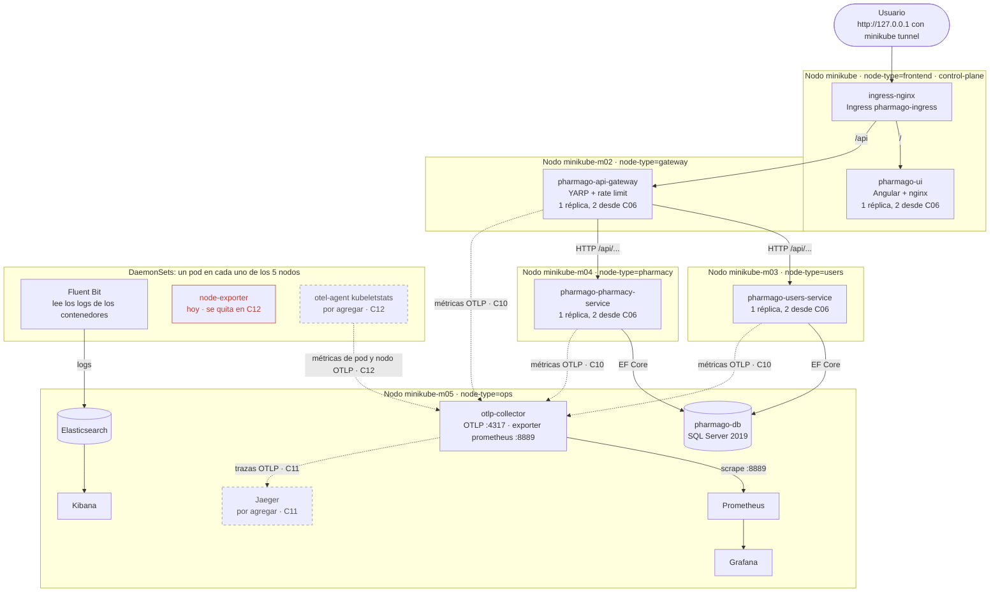

# Diagrama de despliegue

Cumple el pedido de la letra: *"Cada microservicio debe ejecutar en un pod independiente. Los microservicios no pueden ejecutar en mismos nodos físicos. Se debe implementar un diagrama de despliegue."*

Cluster Minikube de 5 nodos (decisión D01), namespace `pharmago`. Las cajas con borde punteado y la etiqueta *por agregar* todavía no existen en los manifiestos y se suman en el commit indicado. El diagrama refleja el estado del repo al cerrar C03 y se actualiza en C23.

**Cómo leerlo.** Las flechas llenas existen hoy. Las punteadas se agregan en el commit que indican. Los cuatro microservicios (UI, gateway, users y pharmacy) están cada uno en un nodo propio. Todo lo de operación comparte el nodo `ops`.

## Qué corre en cada nodo y por qué

| Nodo | `node-type` | Corre | Por qué |
|---|---|---|---|
| `minikube` (control-plane) | `frontend` | `pharmago-ui`, ingress-nginx | La UI es el único microservicio que el usuario pide directo. El addon ingress de Minikube corre en el nodo principal, así que la entrada y la UI quedan juntas y el camino a `/` no cruza nodos. |
| `minikube-m02` | `gateway` | `pharmago-api-gateway` | El gateway es el borde de la API: rate limit y, desde C07, circuit breaker. Si satura su nodo (por ejemplo, con el caos de requests), no le saca CPU a los servicios de atrás. |
| `minikube-m03` | `users` | `pharmago-users-service` | Un nodo por microservicio, como pide la letra. Un fallo o una sobrecarga de users no afecta a pharmacy. |
| `minikube-m04` | `pharmacy` | `pharmago-pharmacy-service` | Igual que users. |
| `minikube-m05` | `ops` | BD, Collector, Prometheus, Grafana, Elasticsearch, Kibana y, desde C11, Jaeger | No son microservicios de la app, así que la letra no les exige nodo propio. Juntarlos deja libres los otros 4 nodos y permite tener los volúmenes persistentes (BD, Prometheus, Grafana y Elasticsearch) en un único nodo fijo. La BD es una sola réplica: punto único de falla aceptado (D04). |
| Los 5 | — | Fluent Bit (y otel-agent desde C12) | Son DaemonSets: cada pod lee los logs (y desde C12 las métricas del kubelet) **del nodo donde corre**, así que tiene que haber uno en cada nodo. No son microservicios. |

## Cómo se garantiza la separación

Cada Deployment de microservicio tiene dos reglas en `spec.template.spec.affinity`:

- **`nodeAffinity` por `node-type`** (`required`): manda cada microservicio a su nodo. Hace la colocación predecible. Sin ella, el scheduler podría repartir las 2 réplicas del primer microservicio en dos nodos y dejar al último sin nodo libre (`Pending`).
- **`podAntiAffinity`** (`required`, `topologyKey: kubernetes.io/hostname`): el pod no puede ir a un nodo donde ya haya pods con `app` igual a cualquiera de los **otros tres** microservicios. Es la garantía dura de la letra: aunque alguien etiquete mal un nodo o quite la `nodeAffinity`, Kubernetes deja el pod en `Pending` antes que juntar dos microservicios. No se excluye a sí mismo, porque las réplicas de un mismo microservicio pueden compartir nodo (D02).

Riesgo aceptado (D03): si se cae un nodo entero, se cae el microservicio que vive ahí, porque sus réplicas comparten ese nodo. Con 5 nodos no hay lugar para repartirlas sin romper la separación.

La comprobación automática es `Implementacion K8S/Codigo/k8s/verify/check-separacion.sh`. La evidencia está en `docs/evidencia/C03/`.

## Hoy, y lo que cambia más adelante

- **Métricas:** hoy Prometheus todavía scrapea directo las apps, node-exporter y cAdvisor, como venía en el repo de la cátedra. La letra pide que las métricas viajen por OTLP: desde C10 (métricas de la app) y C12 (pod, contenedor y nodo, con `otel-agent`), Prometheus solo scrapea al Collector (D30, D31). Ese scrape directo no se dibuja porque se elimina.
- **Trazas:** Jaeger y el pipeline de trazas del Collector se agregan en C11.
- **Réplicas:** los 4 microservicios pasan de 1 a 2 réplicas en C06. Las dos réplicas de cada uno quedan en el mismo nodo.
