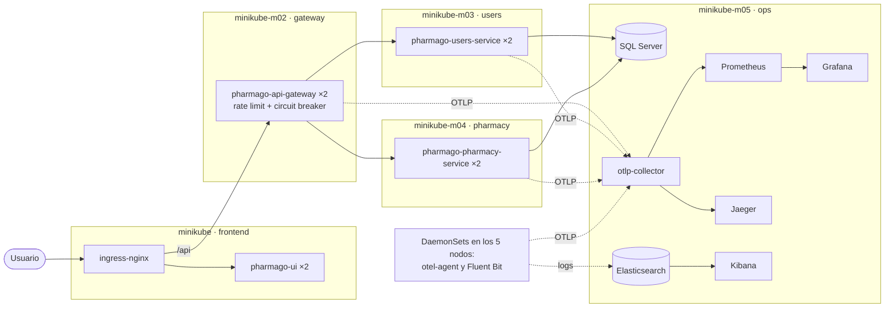

# Obligatorio AIOps: operación de PharmaGo sobre Kubernetes

**Universidad ORT Uruguay · Facultad de Ingeniería · AIOps · 2026**

**Autores:** Franco Álvarez (294234) · Ignacio Aramburu (235991) · Martín Roux (254820)

**Repositorio:** `github.com/NachoAramburu/AIOps---294234-235991-254820` · **Entrega:** 16/11/2026

## Introducción y supuestos

Se partió de PharmaGo (microservicios .NET 6 y frontend Angular 14) y se trabajó sobre su operación sin agregar funcionalidad de negocio. Cada afirmación de este informe remite a evidencia ejecutada en `docs/evidencia/`. Lo que no se pudo verificar está marcado así en `docs/PROGRESO.md`. La correspondencia entre la letra y la evidencia está en `docs/MATRIZ_CUMPLIMIENTO.md`. Todas las mediciones se hicieron en un cluster Minikube de 5 nodos (2 CPU y 4 GB cada uno) sobre las PC de los integrantes.

**Supuestos declarados:** (1) un nodo de Minikube cuenta como nodo físico; (2) la base de datos es una sola instancia de SQL Server, un punto único de falla aceptado (D04 en `docs/DECISIONES.md`); (3) las dos réplicas de un mismo microservicio comparten nodo, porque con 5 nodos no hay lugar para repartirlas sin romper la separación entre microservicios (D02, D03); (4) el dataset de anomalías de los docentes se entrega el día de la defensa; (5) el monolito heredado (`PharmaGo.WebApi`) no se despliega.

## 1. Implementación de plataforma

**Desafíos.** La primera idea fue una anti-afinidad común a todos los microservicios. Con 2 réplicas eso exigía 6 nodos (7 durante un rollout) y dejaba pods en `Pending`. La letra pide que *los microservicios* no compartan nodo, no cada réplica, así que se usó `podAntiAffinity` obligatoria solo contra los *otros* microservicios, más `nodeAffinity` por la etiqueta `node-type`. Sin esta última, el scheduler podía repartir las réplicas del primer microservicio en dos nodos y dejar al último sin lugar. El entorno también tuvo sus problemas: Calico no arrancaba con el kernel de WSL 5.15 (se resolvió actualizando WSL), Fluent Bit exige el runtime `docker` y el script de datos iniciales no lo ejecutaba nadie, así que sin él no había login. La memoria fue el límite principal: el nodo de operación usa unos 3,5 de sus 4 GiB.

**Resultados.** Cada microservicio corre en su propio nodo y todo lo de operación comparte un quinto nodo:

Un cluster levantado desde cero con `k8s/full-up.sh` quedó con 25 pods 1/1 Running en 16 min 13 s, con las imágenes en caché. `check-separacion.sh` dio OK y coincidió con el diagrama completo de `docs/diagrama-despliegue.md`. Una prueba negativa forzó un pod con la etiqueta de users en el nodo del gateway: Kubernetes lo dejó en `Pending` antes que juntar dos microservicios (`docs/evidencia/C03/05`). La aplicación se accede por Ingress en `http://127.0.0.1` con `minikube tunnel`, sin port-forward.

## 2. Alta disponibilidad

**Desafíos.** El único salto HTTP real es gateway → servicio. Los clientes HTTP entre servicios están registrados, pero ningún controlador los usa. Por eso la resiliencia se implementó en el gateway (YARP), con Polly dentro de la fábrica de clientes HTTP de YARP. Aparecieron tres obstáculos. **(a)** Los health checks activos de YARP dejaban el gateway en 503 más de 40 s después de recuperado el servicio, así que se apagaron: Kubernetes ya saca del Service los pods no listos. **(b)** El rate limit compara rutas exactas: sin exceptuar `/health/live` y `/health/ready`, los probes agotaban el límite horario en unos 33 minutos. **(c)** Al borrar un pod apareció un 502 en el mismo segundo: Kubernetes envía la señal de apagado y saca el pod del Service al mismo tiempo, y en ese instante el gateway todavía le enviaba requests. Se corrigió con `preStop: sleep 5` y un reintento de los GET ante errores de conexión.

**Mecanismos.** 2 réplicas por microservicio. Probes rápidas: startup sin espera inicial, readiness cada 2 s y liveness cada 3 s, con 2 fallas para actuar. `/health/ready` chequea la base de datos en users y pharmacy. Un PDB `minAvailable: 1`. En el gateway: timeout de 3 s por intento; 2 reintentos (solo GET/HEAD) con backoff exponencial y jitter; y un circuit breaker por servicio, que abre con 50 % de fallas en 10 s y un mínimo de 8 requests, responde 503 inmediato con `Retry-After` durante 5 s y pasa a half-open. Los POST nunca se reintentan, para no duplicar una compra. Antes del breaker actúa el rate limit del borde (429).

**Resultados** (`docs/mttr.md`, imágenes `be11702`, 1 request/s para no confundir 429 con caída):

| Falla | Tiempo hasta 2/2 Ready | Errores vistos por el usuario |
|---|---|---|
| Borrado de pod: gateway / users / pharmacy / UI | 4,1 / 5,4 / 6,7 / 5,4 s | 0 de 40 en cada caso |
| Crash del proceso (`kill 1`): gateway / users / pharmacy / UI | 4,4 / 8,8 / 7,4 / 3,0 s | 0 de 40 en cada caso |
| Línea de base: UI con 1 réplica, antes de los cambios | ~14 s | 14 de 40 |

Con users a 0 réplicas, el gateway devolvió `503 circuit_open` desde la cuarta request y volvió a *Closed* al restaurarse el servicio. Con varios usuarios y la red de users cortada, el breaker abrió a los 14 s y pasó a responder en menos de 0,1 s en vez de esperar los 9 s de los reintentos. El servicio que no estaba afectado siguió con 0 errores. **Límite hallado:** con menos de 8 requests en 10 s el breaker no abre y la falla se ve solo como latencia (experimento E5a).

## 3. Despliegues seguros

**Técnica elegida: RollingUpdate** con `maxSurge: 1`, `maxUnavailable: 0` (la capacidad nunca baja), `minReadySeconds: 5`, readiness contra la base, `preStop: sleep 5` y `revisionHistoryLimit: 5`. Se descartó Blue/Green porque duplica todos los pods durante el cambio, y en nodos de 4 GB eso no entra. Canary requiere repartir tráfico por porcentaje (anotaciones del Ingress o un service mesh), infraestructura que la letra no pide. Las imágenes propias se etiquetan con el SHA corto del commit (ninguna `:latest`). `k8s/deploy.sh <tag>` actualiza los 4 microservicios de a uno y, si un rollout no termina en 180 s, lo vuelve atrás. `k8s/rollback.sh` vuelve a la revisión anterior. La justificación completa está en `docs/despliegue-seguro.md`.

**Desafíos.** El 502 del borrado de pod (sección 2) era el mismo riesgo del rollout. La verificación cruzada encontró además que `deploy.sh` anotaba el motivo del cambio antes de cambiar la imagen, y el historial mostraba el tag equivocado después de un rollback. Se corrigió el mismo día (C08-ajuste) y se verificó en el cluster.

**Resultados.** `test-rollout.sh` envió **145 requests durante v1 → v2 → rollback de los 4 microservicios, con 145 respuestas 2xx, 0 no-2xx y 0 429**. Un despliegue con una imagen inexistente (E8) dejó el rollout trabado, pero las réplicas viejas siguieron 2/2: 0 errores en 150 requests, y `rollback.sh` lo resolvió en 1 s.

## 4. Telemetría

**Desafíos.** OpenTelemetry no se podía actualizar en el proyecto compartido `Instrumentation`, porque el monolito lo referencia y el build fallaba (NU1605). Se creó el proyecto `PharmaGo.Telemetry`, referenciado solo por los 3 servicios. El repositorio original hacía que Prometheus scrapeara las apps, node-exporter y cAdvisor; la letra pide OTLP hacia Prometheus. Se reemplazó todo por un DaemonSet `otel-agent` (receiver `kubeletstats`, uno por nodo) más el receiver `k8s_cluster` en el Collector. Prometheus quedó con **un único target**: el exporter del Collector. El cluster tiene límites propios. Con cri-dockerd el kubelet no informa red por pod, pero como cada microservicio tiene su nodo, la red del nodo es la del microservicio. Además, los 5 nodos comparten el disco del host, así que para storage se usa el ephemeral-storage de cada pod. Al probar las alertas aparecieron dos falsos positivos en reposo. Sin tráfico, dos queries daban `NaN` (0/0) y Grafana las evaluaba como superiores al umbral (D56). El propio Collector estaba al 92 % de su memoria y disparaba `pg-memory` (D55). Ambas se corrigieron con evidencia de antes y después.

**Resultados.**

- **Logs:** formato JSON de consola en los 3 servicios .NET y JSON en nginx. Las 298 líneas del gateway son JSON y 291 llevan `trace_id`. Fluent Bit las envía a Elasticsearch, y Kibana usa un data view creado por script. Se verificó el recorrido completo: desde una traza de Jaeger se encontraron en Kibana sus 3 logs, de 2 servicios.
- **Trazas:** OTLP → Collector → Jaeger, con propagación W3C `traceparent` a través de YARP. Un login produce 5 spans: gateway, cliente HTTP, users y 2 consultas SQL con su texto. Los probes se filtran para no llenar Jaeger de ruido.
- **Métricas:** de app (tráfico, errores, latencia y estado del breaker), de nodo (CPU, memoria, red y disco), y de pod/contenedor (CPU y memoria contra el límite, filesystem, reinicios y réplicas). Las series por nodo se distinguen: por ejemplo, 3,9 GB de memoria en `ops` contra 0,86 GB en los nodos de servicios. Hay dos dashboards provisionados, Overview (Golden Signals) e Infra.
- **10 alertas como código** (`k8s/configmaps/grafana-alerting.yaml`). Cada una tiene query, umbral, ventana, severidad y playbook:

| Alerta | Señal | Umbral / ventana | Disparo medido (E = experimento) |
|---|---|---|---|
| `pg-5xx` | Errores | > 5 % / 30 s | 55-61 s (E5b, E6) |
| `pg-latency` | Latencia | P95 > 1000 ms / 1 min | 92 s (E5a) |
| `pg-latency-anomaly` | Anomalía | z-score > 3 sobre 30 min | Necesita 30 min de historia |
| `pg-429` | Tráfico | > 1/s / 30 s | 50 s (E1) |
| `pg-cpu` / `pg-memory` | Saturación | > 80 % / > 85 % del límite / 30 s | 70 s (E2) / 59 s (E3b) |
| `pg-storage` | Saturación | > 300 MiB / 30 s | 76 s (E4c) |
| `pg-restarts` / `pg-replicas` | Errores / disponibilidad | > 0 / 0 s y 30 s | Sin disparos falsos en E7 |
| `pg-breaker` | Errores | breaker abierto / 0 s | 33 s (E5b, E6) |

**Hallazgo:** entre una falla y su alerta hay un piso de unos 30 s (medición cada 5-10 s, Collector, scrape cada 5 s y evaluación cada 10 s). No se bajaron las ventanas, porque eso haría disparar las alertas ante picos de un instante.

## 5. Técnicas de detección de anomalías

**Protocolo.** Se siguió el del laboratorio del curso, que es estrictamente no supervisado. `StandardScaler` y los modelos se ajustan sobre todas las ventanas, incluidas las anómalas, y las etiquetas se usan recién al final para evaluar. Hiperparámetros: `IsolationForest(n_estimators=300, max_samples=min(256, n), contamination=0.10, random_state=42)` y `OneClassSVM(kernel="rbf", nu=0.10, gamma="scale")`. `contamination` y `nu` se interpretan como **presupuesto de alertas** (cuántas puede investigar la guardia), no como la tasa real de anomalías, que en producción se desconoce.

**Resultados** (300 minutos sintéticos, 17,7 % anómalos; dos corridas dieron resultados idénticos bit a bit):

| Método | Precisión | Recall | F1 | Alertas |
|---|---|---|---|---|
| Isolation Forest (4 métricas) | 0,800 | 0,453 | 0,578 | 30 |
| One-Class SVM RBF (4 métricas) | 0,621 | 0,340 | 0,439 | 29 |
| MAD sobre latencia (referencia univariada) | 1,000 | 0,679 | 0,809 | 36 |

Con 30 alertas para 53 minutos anómalos, el recall máximo posible es 0,566. Isolation Forest gana con el mismo presupuesto (24 aciertos contra 18). Además detecta combinaciones raras que ningún detector univariado ve, como el evento `combo_sutil`, donde ningún eje pasa de 2,7 desvíos. One-Class SVM ve mejor lo que se sale por un solo eje, pero gasta alertas en el borde de tráfico alto. Ninguno detecta la degradación lenta (0 y 1 de 18 minutos), porque evalúan cada minuto sin memoria; harían falta features de tendencia. **Los falsos positivos con historia** son un job batch (CPU de 71-82 % con tráfico normal) y un pico de carga legítimo. Un detector no supervisado mide rareza, no daño, y se corrige con contexto: excluir ventanas de jobs conocidos o usar relaciones entre métricas en lugar de valores crudos. El detector k-sigma del laboratorio se llevó además a producción como la alerta `pg-latency-anomaly`.

**Dataset de los docentes.** `deteccion_dataset_docentes.ipynb` aplica los dos modelos, con los mismos hiperparámetros, a cualquier CSV indicado por variables de entorno. Se probó con el dataset del laboratorio exportado a CSV y reprodujo exactamente sus métricas. El dataset se entrega el día de la defensa y se corre ahí.

## 6. Plan de contención de incidentes operacionales

**Contenido** (`docs/plan-incidentes.md`): el ciclo del curso Prepare → Detect → Respond → Recover → Learn; tres severidades con criterios medibles en alertas y paneles concretos (SEV1: breaker abierto más de 30 s o un microservicio en 0 réplicas; SEV2: 5xx entre 5 y 50 % o P95 > 1 s; SEV3: 429 o un reinicio que se resolvió solo); roles **IC** (Martín Roux), **Ops** (Ignacio Aramburu) y **Comms** (Franco Álvarez), con reemplazos si falta alguno y la regla de que quien teclea no decide; comunicación en circuito cerrado y estado a intervalos fijos; y un protocolo para la falla desconocida del script docente, que recorre los Golden Signals de afuera hacia adentro (errores, latencia, tráfico, saturación, estado de Kubernetes y red) con una tabla de triage. Hay **8 playbooks** (`docs/playbooks/`: requests, CPU, memoria, storage, red, desconexión, pod caído y rollout fallido). Cada uno tiene síntoma, alerta, panel, tiempo esperado de mitigación automática, mitigación manual y validación. Se suman plantillas de registro y de postmortem blameless.

**Desafíos.** Un plan que nombra alertas o paneles inexistentes falla justo en el war room. `k8s/verify/check-playbooks.sh` verifica que cada alerta tenga playbook y que cada playbook nombre solo alertas y paneles reales. El ensayo del playbook de memoria encontró una acción que fallaba (`kill` no existe como binario en la imagen) y se corrigió. Los tiempos esperados de cada playbook son los medidos en los experimentos, no estimaciones.

**Resultados.** El postmortem de ejemplo (`docs/incidentes/ejemplo-postmortem.md`) analiza una caída real de la base de datos: 64 requests fallidas y recuperación automática 8 s después de que volvió la base, sin reiniciar los microservicios.

## 7. Scripts de caos

**Implementación** (`chaos-engineering/`): `load-requests.sh` (ráfaga concurrente contra login), `cpu-spike.sh` (hilos en un contenedor), `ram-spike.sh` (memoria retenida en el cgroup), `volume-spike.sh` (escritura en el ephemeral-storage), `network-chaos.sh` (NetworkPolicy deny-all con Calico) y `disconnect.sh` (escala el componente a 0). Todos reciben como parámetros el objetivo, la intensidad y la duración, solo actúan sobre el contexto `minikube` y el namespace `pharmago`, y restauran el estado con `trap`, incluso ante Ctrl+C. `steady-state.sh` verifica el estado sano y `observar.sh` registra lo que ve el usuario y el estado de las alertas.

**Desafíos.** En Git Bash, el `trap` no corría mientras bash esperaba a `kubectl.exe`, así que se reemplazó la espera por un loop (D53). El `cpu-spike` original dejaba loops vivos y el `ram-spike` original escribía en `/dev/shm`, de 64 MB. Las propias herramientas de medición resultaron engañosas: `ram-spike.sh` construía una sola cadena que duplicaba la memoria y el OOM la mataba antes de que la alerta pudiera verla (D57), y el timeout de 3 s del observador escondía los 504 del gateway. Ambas se corrigieron antes de repetir los experimentos.

**Resultados** (`chaos-engineering/EXPERIMENTOS.md`: cada experimento tiene steady state, hipótesis falsable, blast radius, métrica, criterio de éxito y criterio de aborto):

| Experimento | Errores del usuario | Alerta (Firing) | Recuperación | Hipótesis |
|---|---|---|---|---|
| E1 ráfaga de 300 a login | 0/150 en otro endpoint | `pg-429` 50 s | Inmediata | Confirmada |
| E2 CPU al 100 % del límite | 0/200 (P95 60 ms) | `pg-cpu` 70 s | Normal 30 s después | Refutada (> 60 s) |
| E3b 250 MB sostenidos | 0/210 | `pg-memory` 59 s | Normal 23 s después | Confirmada |
| E4 600 MB en disco | 0/210 | Ninguna: desalojo a 47 s | 2/2 en 9 s | Confirmada |
| E5b red cortada, varios usuarios | Fallan solo los endpoints de users | `pg-breaker` 33 s | 200 a los 3 s | Refutada por poco |
| E6 pharmacy a 0 réplicas | 0/85 en users | `pg-breaker` 33 s | 2/2 en 14 s | Refutada por poco |
| E7 borrado de pod | 0/140 | Ninguna | MTTR 8,6 s | Confirmada |

De 11 experimentos se refutaron 5 hipótesis, y de ahí salió lo más útil: el piso de detección de unos 30 s, que las fallas más rápidas que esa cadena se resuelven solas sin alerta (la señal queda en los eventos `OOMKilled` y `Evicted`), y que el breaker necesita tráfico. Ningún umbral se cambió sin una medición que lo justificara.

## 8. Defensa

`docs/runbook-defensa.md` reúne el arranque desde cero con tiempos medidos, un checklist de 30 minutos antes, qué pantalla abre cada rol y una **matriz falla → mecanismo → alerta → panel → mitigación → por qué**. Esa matriz explica, con valores medidos, qué mecanismo produce cada comportamiento observable. El runbook incluye además el protocolo frente al script desconocido y qué hacer si falla el entorno (tunnel, Grafana sin datos, nodo NotReady). El ensayo técnico de los 6 tipos de falla, con un cluster levantado desde cero (C23), repitió los tiempos de los experimentos: `pg-429` a 45 s, `pg-cpu` a 66 s, `pg-memory` a 65 s, `pg-breaker` a 28-39 s, y 0 errores del usuario en las fallas que los mecanismos cubren. El ensayo con los tres integrantes en sus roles, con una falla elegida sin aviso, se registra en `docs/evidencia/C23/04-ensayo-equipo.md` antes del 23/11.

## 9. Extensiones: CI/CD y BDD

El pipeline de GitHub Actions corre en cada push y en cada Pull Request a `main`. Compila el backend y corre los 291 tests; compila Angular; valida todos los manifiestos con kubeconform; corre los escenarios BDD `@smoke` (Cypress + Cucumber, con la API simulada); y solo si todo pasa construye las 4 imágenes con el tag del SHA. Una corrida completa terminó con los 8 jobs en verde en 3 min 26 s. Los escenarios `@e2e` pasaron 2/2 contra el Ingress real. El despliegue sigue siendo local, porque el runner de GitHub no llega a un Minikube en una PC (D47). Al armar el pipeline se corrigió el único test que fallaba en el repositorio heredado, que suponía `Id == 1` sobre una base en memoria compartida.

## 10. Reflexión sobre prácticas ágiles

**Lotes chicos con definición de "hecho" verificable.** El trabajo se dividió en 24 tareas; hasta el runbook de la defensa se hicieron 21 commits entre el 9 y el 15/11. Cada commit cerraba con evidencia ejecutada, una sección en `docs/PROGRESO.md` y la marca `NO VERIFICADO` para lo que no se pudo probar. Esa regla evitó acumular "funciona en mi máquina": cuando un integrante no tenía Docker, su trabajo quedaba como parcial hasta que otro lo verificaba en su cluster.

**Inspeccionar y adaptar.** El 13/11, con 17 tareas por delante, se replanificó en 9 bloques ordenados por dependencias, tres por integrante. La verificación cruzada funcionó como revisión entre pares: B1-verificación encontró el error del historial de rollout y C08-ajuste lo corrigió el mismo día. Los experimentos de caos aplicaron la misma lógica empírica a la operación: cada hipótesis refutada produjo un ajuste medido (memoria del Collector, queries con `NaN`, `ram-spike.sh`) en lugar de una opinión.

**Retroalimentación automática.** El pipeline dio en 3,5 minutos una respuesta que antes requería levantar un cluster de 16 minutos. El registro de decisiones (51 entradas, cada una con motivo y fuente) cumplió el papel de documentación liviana: permitió que tres personas trabajaran en paralelo sin rediscutir lo ya decidido.

**Qué no funcionó tan bien.** El trabajo se concentró al final: 12 de los 21 commits son del 14 y 15/11. El seguimiento se llevó en archivos del repositorio (`docs/tablero.md` y `docs/PROGRESO.md`) más que en el tablero de GitHub. La verificación dependió de las PC con memoria suficiente para el cluster, que fueron un cuello de botella. La cobertura BDD es chica (2 features) y se priorizó la verificación operativa sobre la funcional.

## 11. Uso de inteligencia artificial generativa

**Herramienta:** Claude Code con el modelo Claude Opus 5.5, en todos los commits (`docs/USO_IA.md` registra fecha, integrante, contexto, qué generó la IA y qué se modificó). **Contextos de uso:** análisis de la letra y diseño del plan de tareas; generación de código, manifiestos y scripts; ejecución de los comandos de verificación y registro de su salida; redacción inicial de la documentación y de este informe. **Control:** ningún commit se hizo sin que el integrante responsable lo revisara y escribiera "revisado". Ninguna afirmación se aceptó sin evidencia ejecutada.

La verificación encontró errores en lo que la IA había propuesto, y se corrigieron con mediciones: la anti-afinidad del plan inicial necesitaba 6 nodos (D02); el protocolo de anomalías del plan ajustaba solo con datos normales, lo que contradice "no supervisado" (D40); los límites de memoria propuestos para `otel-agent` lo dejaban al borde del OOM (D38); y `ram-spike.sh` no generaba la presión que decía (D57). Para cuidar la privacidad, ninguna contraseña aparece en la evidencia: el seed y las pruebas toman la clave de un `Secret` o de una variable de entorno. Las versiones de imágenes y paquetes que propuso la IA se confirmaron contra los registros oficiales antes de usarlas.
