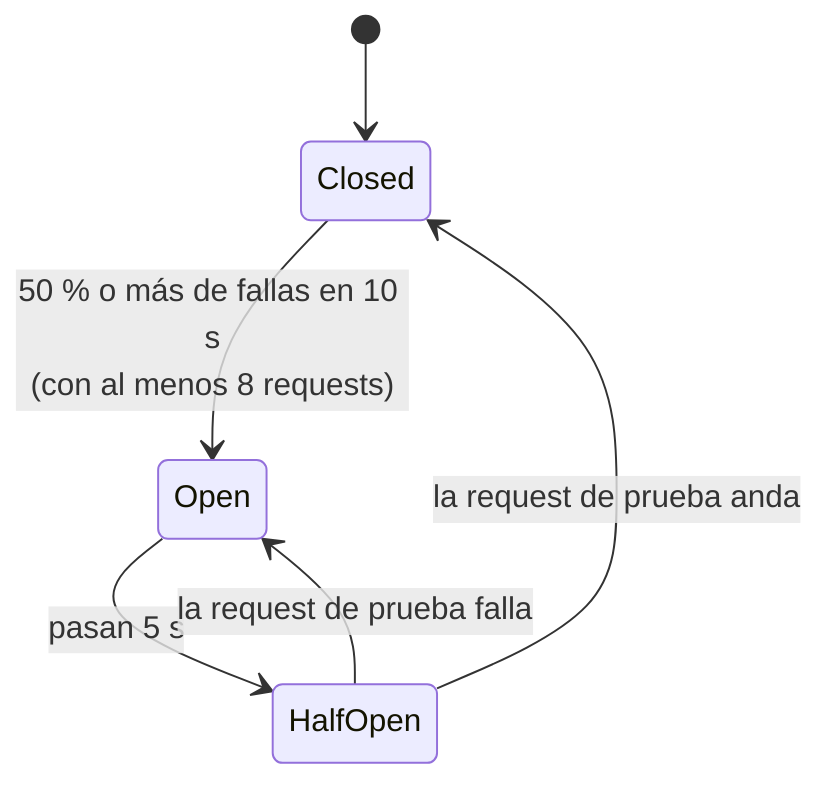

# Resiliencia ante fallas reiteradas (C07)

La letra pide que el sistema sea "resiliente a ataques que inciten fallas reiteradas" y que se implemente "algún patrón que mitigue la eventualidad de tener un alto volumen de solicitudes fallidas". Se resolvió con dos patrones que se complementan:

| Dónde | Patrón | Qué evita |
|---|---|---|
| Borde (gateway, antes de enrutar) | Rate limiting con 429 (`AspNetCoreRateLimit`) | Que un cliente sature el sistema con volumen |
| Salto gateway → servicio | Circuit breaker + reintentos con backoff y jitter + timeout por intento (Polly en YARP) | Que un servicio que falla reciba más tráfico, se acumulen requests y el fallo se propague |

## Por qué en el gateway

`PharmacyServiceClient` y `UsersServiceClient` están registrados pero ningún controlador los usa: no hay llamadas HTTP entre servicios. El único salto HTTP real es **gateway → servicio**, a través de YARP. Por eso la resiliencia se implementa ahí, en `PharmaGo.ApiGateway/Resilience/ResilientForwarderHttpClientFactory.cs`, que reemplaza la fábrica de clientes HTTP de YARP.

## Cómo funciona el circuit breaker

- **Closed:** pasan todas las requests y se cuentan las fallas. Falla = error de conexión, timeout o respuesta 5xx.
- **Open:** durante 5 s el gateway responde **503 al instante**, con `Retry-After: 5` y el cuerpo `{"error":"circuit_open"}`, sin llamar al servicio. Así el servicio tiene aire para recuperarse.
- **Half-Open:** deja pasar una request de prueba. Si anda, vuelve a Closed; si falla, vuelve a Open.

Hay un breaker por cluster de YARP (`users-cluster` y `pharmacy-cluster`): si se cae users, pharmacy sigue atendiendo. El estado se publica como la métrica `pharmago_circuit_breaker_state{cluster}` (0 closed, 1 open, 2 half-open), y cada transición queda en el log del gateway como `circuit_breaker cluster=... state=...`.

## Parámetros (`appsettings.json`, sección `Resilience`)

| Parámetro | Valor | Por qué |
|---|---|---|
| `PerTryTimeoutSeconds` | 3 | Las consultas normales tardan milisegundos. 3 s deja margen bajo carga de CPU sin dejar al usuario colgado: en el peor caso, un GET tarda unos 9,5 s (3 intentos). |
| `RetryCount` | 2 | Alcanza para absorber el corte de un pod que muere (la otra réplica responde) sin multiplicar demasiado la carga. |
| `RetryBaseDelayMs` | 100 | Espera de 100 ms y 200 ms más un jitter aleatorio de 0 a 100 ms. El jitter evita que muchos clientes reintenten todos a la vez. |
| `BreakerFailureRatio` | 0.5 | Abre cuando la mitad de las requests fallan: es un servicio roto, no un error aislado. |
| `BreakerSamplingSeconds` | 10 | Ventana corta para reaccionar en segundos, que es lo que pide la letra para el MTTR. |
| `BreakerMinimumThroughput` | 8 | Con poco tráfico, 1 falla de 2 no debe abrir el circuito. |
| `BreakerDurationSeconds` | 5 | Corto a propósito: un pod nuevo tarda entre 5,7 y 9 s en estar Ready (lo midió C06), así que a los 5 s ya conviene probar si hay réplicas sanas, sin hacer esperar de más al usuario. |
| `PooledConnectionLifetimeSeconds` | 15 | Las conexiones del gateway se renuevan cada 15 s: el tráfico rota entre réplicas y abandona pods muertos. |

## Qué se reintenta y qué no

- **GET y HEAD** se reintentan ante errores de conexión, timeouts y respuestas 502, 503 o 504.
- **Un 500 no se reintenta:** es un error de la aplicación y repetir no lo arregla.
- **POST, PUT y DELETE nunca se reintentan:** podría duplicarse una compra o una alta. Igual cuentan para el breaker.

## Cómo convive con el rate limit

El rate limit actúa primero, en el borde: 100 requests por minuto y 1000 por hora por IP y endpoint, y 10 por minuto en login. Pasado el límite responde **429**, que no es una falla del servicio y no cuenta para el breaker. Los endpoints de salud (`/health/live`, `/health/ready`) están exceptuados, porque si no, los probes de Kubernetes agotarían el límite horario.

## Health checks de YARP

Quedan apagados (decisión D14 de `docs/DECISIONES.md`). Cada cluster tiene un único destino, el Service de Kubernetes, y Kubernetes ya saca de ese Service los pods que no están listos. En una prueba con los checks activos, después de recuperarse el backend el gateway siguió respondiendo 503 durante más de 40 s, lo que empeoraba el MTTR.

## Evidencia

- Prueba local del gateway real contra un backend falso: `docs/evidencia/C07/01-gateway-local.txt`. El circuito pasa por Closed, Open, Half-Open y Closed; un 500 no se reintenta; un POST con el circuito abierto no llega al servicio; el timeout corta cada intento a los 3 s; aparece 429 desde el request 101.
- Prueba en el cluster: `Implementacion K8S/Codigo/k8s/verify/test-circuit-breaker.sh`. Escala users a 0, pide `/api/roles` a 2 por segundo y exige ver `503 circuit_open` y la recuperación posterior.
